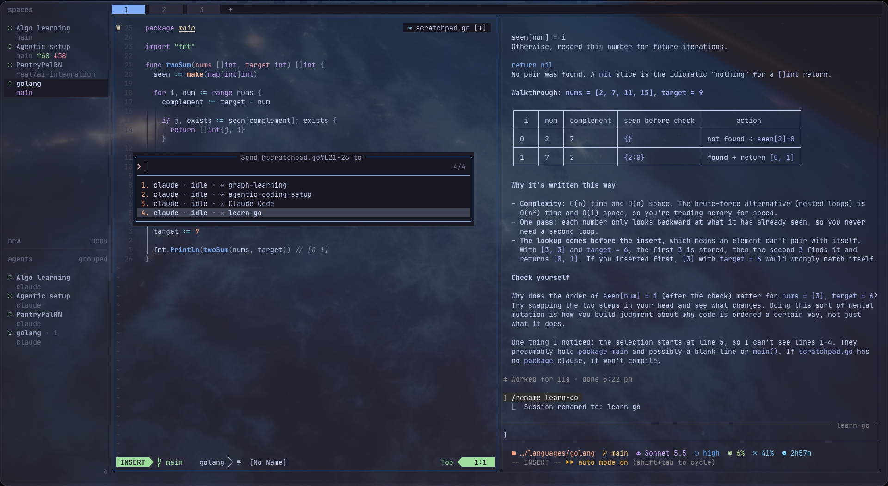

# dotfiles

A macOS terminal setup built around **reviewing what coding agents write**: Ghostty → herdr
→ Neovim 0.12 next to Claude Code (or OpenCode), managed with [chezmoi](https://chezmoi.io).



> [!NOTE]
> This is my personal setup, shared to read and borrow from. Don't apply it blindly:
> `chezmoi apply` replaces your `~/.zshrc`, `~/.zprofile`, `~/.gitconfig` and several
> `~/.config` folders. Every choice and its reason is in [`docs/decisions.md`](docs/decisions.md).

## What makes it different

- **Agents live in herdr panes**: sessions survive closing the terminal, and you get a notification when one finishes or needs you.
- **Review is a git loop**: walk the agent's hunks in Neovim, stage to accept, reset to reject (`]h`, `<leader>gs`, `<leader>gr`, `<leader>gd`).
- **Point, don't describe**: `<leader>as` types `@src/api.ts#L12-20` into the agent you pick, never pressing Enter for you.
- **Formatting follows the project**: format-on-save runs only the formatter a repo declares, so nothing else gets rewritten.
- **Neovim 0.12 built-ins first**: `vim.pack`, ui2 and `vim.lsp.enable`, with no plugin manager or distribution.
- **Tested and guarded**: a headless test suite covers the config, and a gitleaks hook plus CI keep secrets out.

## What's inside

| Path | What |
|---|---|
| `dot_config/nvim/` | Neovim config: `lua/tan/{config,plugins,utils}`, per-server settings in `after/lsp/` |
| `dot_config/herdr/` | herdr: prefix `ctrl+space`, system notifications |
| `dot_config/ghostty/` | Ghostty: Catppuccin Mocha, JetBrains Mono Nerd Font, optional shaders |
| `dot_config/git/`, `dot_gitconfig.tmpl` | Git: identity prompted per machine, delta pager, nvimdiff |
| `dot_zshrc`, `dot_zprofile.tmpl` | Plain zsh (no framework): completion menu, shared history, autosuggestions, syntax highlighting |
| `dot_config/starship.toml`, `dot_config/mise/` | Prompt and runtimes (node, go, python, …) |
| `Brewfile`, `run_onchange_bootstrap.sh.tmpl` | CLI tools and the one-shot machine bootstrap |
| `tests/` | Headless checks for everything above |
| `docs/` | Decision log and roadmap |

Tools come from three places: **brew** for CLI tools, **mise** for runtimes, **Mason**
(inside Neovim) for language servers and formatters.

## Install on a new Mac

```sh
# 1. Homebrew, then put it on PATH for this shell
/bin/bash -c "$(curl -fsSL https://raw.githubusercontent.com/Homebrew/install/HEAD/install.sh)"
eval "$(/opt/homebrew/bin/brew shellenv)"
brew install chezmoi git

# 2. Clone and apply (asks once for your git name, email and GitHub user)
git clone https://github.com/tan-loc-nguyen/dotfiles ~/Workspace/dotfiles
chezmoi init --source ~/Workspace/dotfiles --apply

# 3. Runtimes, in a new login shell (Mason needs node and go for most language servers)
exec zsh -l
mise install

# 4. Open Neovim once: plugins, parsers and language servers install themselves
nvim
```

`chezmoi apply` runs one bootstrap script. Every step skips work that's already done, and
it re-runs by itself when the script, the Brewfile or the installed agent CLIs change:
1. Homebrew + `brew bundle --no-upgrade` (installs what's missing, never upgrades).
2. Claude Code's native installer, if `claude` is missing.
3. herdr's agent integrations, for each agent CLI present (claude, opencode).
4. This repo's pre-commit hook (`git config core.hooksPath .githooks`).

Then turn off macOS's ⌃Space shortcut, which herdr uses as its prefix: System Settings →
Keyboard → Keyboard Shortcuts → Input Sources → untick **Select the previous input source**.

## Living with it

- **Edit config in place.** Files under `~/.config` are symlinks into this repo. The
  exceptions are templates, rendered as copies: `~/.gitconfig` and `~/.zprofile`. Edit
  those in the repo, then `chezmoi apply`.
- **New config files** go in the repo (then `chezmoi apply`), or `chezmoi add` them; a new
  file under `~/.config` isn't in the repo by itself.
- **Not tracked on purpose**: anything in `~/.claude` (Claude Code and herdr rewrite
  `settings.json`), and Neovim's `nvim-pack-lock.json` (plugin versions float per machine).
- **Before every commit**, the hook runs gitleaks with `.gitleaks.toml`: secrets, email
  addresses and `/Users/<name>` paths are refused (write `~` or `$HOME`). CI scans the full
  history on every push.

## Keys

**zsh**: `Shift+Tab` (or `→`) accepts the faded suggestion · `Tab` completes ·
`**<Tab>` fuzzy-picks a path · `⌃R` searches history.

**herdr** (prefix `ctrl+space`): `h/j/k/l` move between panes · `v` / `-` split · `z` zoom ·
`c` new tab · `shift+n` new workspace · `shift+g` new worktree · `o` jump to the
notification · `b` sidebar · `q` detach (`herdr` reattaches) · `?` help.

**Neovim** (leader = Space; press it and wait for which-key):

| Area | Keys |
|---|---|
| Find | `<leader>ff` files · `fg` grep (capital = incl. ignored) · `fb` buffers · `fh` help · `fd` diagnostics · `fs`/`fS` symbols · `<C-p>` |
| Buffers | `<Tab>`/`<S-Tab>` cycle · `<leader>bd` close · `<leader>bh` close hidden · `<C-n>` jump forward |
| Windows | `ss`/`sv` split · `sh sj sk sl` move · `te` new tab (`gt`/`gT`) |
| Files | `-` oil here · `sf` oil float (`q` closes) |
| Review | `]h`/`[h` hunks · `<leader>gs` stage (accept) · `gr` reset (reject) · `gp` preview · `gS`/`gR` whole file · `gb` blame · `gd` CodeDiff tab · `gh`/`gH` history · `gg` lazygit · `gf` file log |
| Code | `gd` `gD` `grr` `gri` `grt` · `K` · `<C-k>` signature · `<leader>cr` rename · `ca` action · `cf` format · `ci` inlay hints · `cd` line diagnostics · `]d` `]e` `]w` |
| Agents | `<leader>yf` copy `@path#L12-20` (normal / visual / oil) · `yp` absolute · `<leader>as` send to a herdr agent |
| Editing | `x` deletes without copying · `<leader>p` pastes the last yank · `<C-a>` select all · `:W` save without formatting |

## Tests

```sh
tests/run.sh          # every check; exits non-zero if any fails
tests/run.sh --cold   # same, with Neovim on fresh data dirs (slow: simulates a new machine)
```

| Check | Covers |
|---|---|
| `tests/nvim/run.sh` | headless Neovim: startup, keymaps, LSP, formatting, parsers, agent helpers, UI |
| `tests/shell/check_zsh.sh` | interactive zsh: emacs keys, comments, Delete/Home/End, PATH, Ruby gems |
| `tests/shell/check_bootstrap.sh` | the bootstrap renders, passes shellcheck, never upgrades brew packages |
| `tests/shell/check_secrets.sh` | the pre-commit hook blocks secrets and personal data; history is clean |

## Roadmap

- [ ] Local models: Ollama + OpenCode, including whether OpenCode understands `@path#L12-20` references
- [ ] AI inline completion in the editor (local model or none)
- [ ] Ghostty Cmd-key shortcuts for herdr actions (e.g. `Cmd+D` to split)
- [ ] Try tsgo, the native TypeScript 7 language server
- [ ] Linux support (common distros): package installs beyond Homebrew, OS checks in the templates

## Credits

- [craftzdog's dotfiles](https://github.com/craftzdog/dotfiles): the reference this setup
  started from (vim.pack layout, herdr, chezmoi structure).
- [herdr](https://github.com/herdrdev/herdr), [codediff.nvim](https://github.com/esmuellert/codediff.nvim),
  [snacks.nvim](https://github.com/folke/snacks.nvim), [Catppuccin](https://github.com/catppuccin/nvim)
  and the other plugins in `dot_config/nvim/lua/tan/plugins/init.lua`.
- Ghostty shaders: see `LICENSE` for their authors and terms.

## License

[MIT](LICENSE), except the third-party files listed in it.
